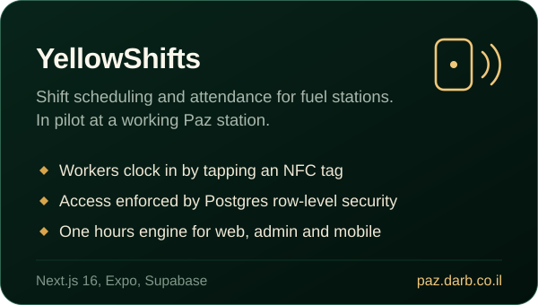
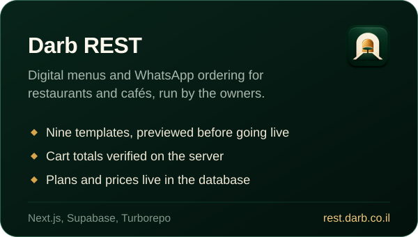
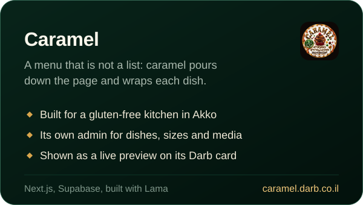
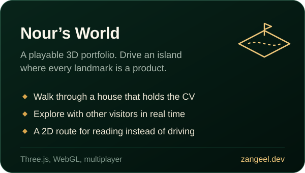

  

 

## Darb

*Darb* means *path* in Arabic. It's what I'm building full time with my co-founder Lama: one path to every local business, and one platform that connects the people searching, the people adding businesses, and the businesses themselves.

It covers the north of Israel today. The goal is every city, town and village in the country, and to expand beyond it from there.

 

**How it's built**

- **Its own backend, built from zero.** No backend-as-a-service: a NestJS API we wrote ourselves for search, places, media, admin, helpers and pricing, on our own PostgreSQL schema with PostGIS and pgvector, Redis for caching and rate limits, and one set of shared zod contracts so a mismatched field between API and web fails the build, not production. The only outside service in the core is Clerk for sign-in.
- **Two-lane search.** An instant index answers in the browser as you type. A language model then reads the intent under a strict schema and a 1.5 s budget, and matches it against what each business offers, down to single menu items. If the model is slow, the instant results stand on their own.
- **One continuous map.** Country, town, category and business are levels of one camera on MapLibre GL, with self-hosted vector tiles on Cloudflare R2, so there's no per-view map bill and no third-party tracking.
- **Real data with sources.** Listings come from government registers and OpenStreetMap, deduplicated and geocoded. Darb Helpers and the admin's street capture fill in the towns the open maps miss, and every addition is reviewed before it goes live.
- **Nothing ships on a red build.** Type checks, about 1,500 unit and integration tests against a real database, Playwright on desktop and phone, WCAG AA checks on every page, per-route performance budgets and a 103-query search quality set run on every pull request.

Next.js 16 · NestJS · Prisma · PostgreSQL with PostGIS and pgvector · Redis · MapLibre GL · Cloudflare R2 · Railway · Vercel · Turborepo

 

## More work

Source: [PazShifts](https://github.com/b14ckPanther/PazShifts) (YellowShifts), [Darb_Rest](https://github.com/b14ckPanther/Darb_Rest), [Caramel](https://github.com/Lzbedat3/Caramel_next) on Lama's profile, [Nour's World](https://github.com/b14ckPanther/Nours-World) (public showcase).

 

## Toolbox

| | |
| :-- | :-- |
| **Languages** |  |
| **Web** |  |
| **Mobile** |  Flutter, React Native with Expo |
| **Backend** |  |
| **Data** |  |
| **Ship** |  |

 

## Contributions

<picture>
  <source media="(prefers-color-scheme: dark)" srcset="https://raw.githubusercontent.com/b14ckPanther/b14ckPanther/output/snake-dark.svg"/>
  <source media="(prefers-color-scheme: light)" srcset="https://raw.githubusercontent.com/b14ckPanther/b14ckPanther/output/snake-light.svg"/>
  
</picture>

 

## Get in touch

I'm happy to talk about Darb, partnerships, local business tech, or engineering work. Email [founder@darb.co.il](mailto:founder@darb.co.il), find me on [LinkedIn](https://www.linkedin.com/in/nmprofessor/), or drive around [zangeel.dev](https://zangeel.dev).

 

© 2026 Nour Alden Mousa

