

  

<a href="#get-in-touch">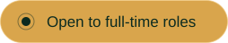</a>

  

<picture>
  <source media="(prefers-color-scheme: dark)" srcset="assets/sections/darb-dark.svg"/>
  <source media="(prefers-color-scheme: light)" srcset="assets/sections/darb-light.svg"/>
  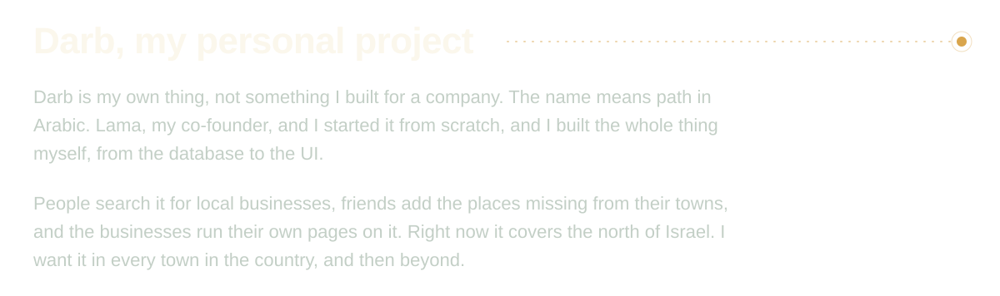
</picture>

 

 

<picture>
  <source media="(prefers-color-scheme: dark)" srcset="assets/sections/darb-built-dark.svg"/>
  <source media="(prefers-color-scheme: light)" srcset="assets/sections/darb-built-light.svg"/>
  
</picture>

<a href="https://darb.co.il/en">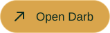</a>

  

<picture>
  <source media="(prefers-color-scheme: dark)" srcset="assets/sections/more-work-dark.svg"/>
  <source media="(prefers-color-scheme: light)" srcset="assets/sections/more-work-light.svg"/>
  
</picture>

<a href="https://github.com/b14ckPanther/PazShifts">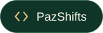</a>
<a href="https://github.com/b14ckPanther/Darb_Rest">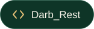</a>
<a href="https://github.com/Lzbedat3/Caramel_next">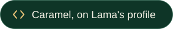</a>
<a href="https://github.com/b14ckPanther/Nours-World">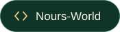</a>

  

<picture>
  <source media="(prefers-color-scheme: dark)" srcset="assets/sections/lab-dark.svg"/>
  <source media="(prefers-color-scheme: light)" srcset="assets/sections/lab-light.svg"/>
  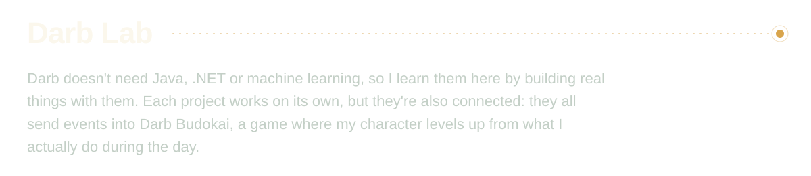
</picture>

<a href="https://github.com/b14ckPanther/darb-capsule">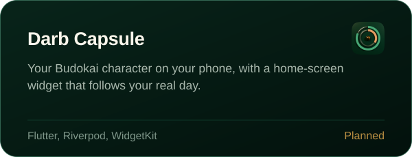</a>
<a href="https://github.com/b14ckPanther/darb-genki">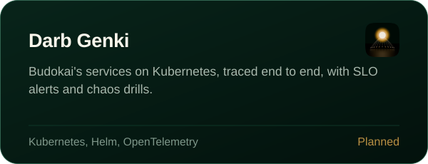</a>

<a href="https://github.com/b14ckPanther/darb-ki">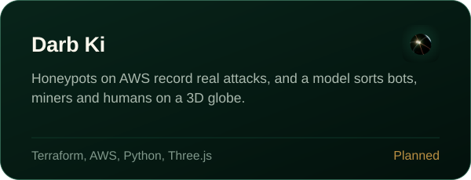</a>
<a href="https://github.com/b14ckPanther/darb-kinton">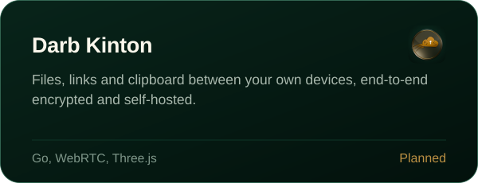</a>

 

<picture>
  <source media="(prefers-color-scheme: dark)" srcset="assets/sections/toolbox-dark.svg"/>
  <source media="(prefers-color-scheme: light)" srcset="assets/sections/toolbox-light.svg"/>
  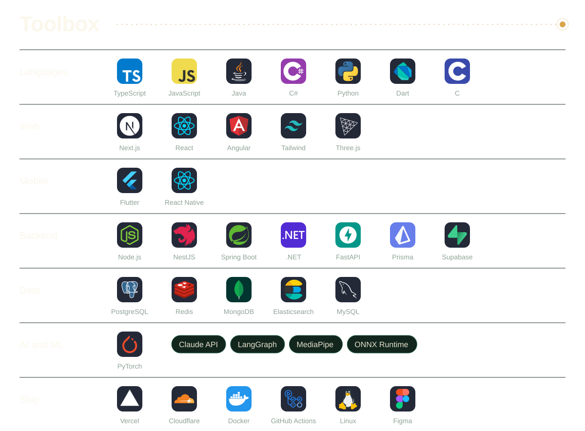
</picture>

  

<picture>
  <source media="(prefers-color-scheme: dark)" srcset="assets/sections/contributions-dark.svg"/>
  <source media="(prefers-color-scheme: light)" srcset="assets/sections/contributions-light.svg"/>
  
</picture>

<picture>
  <source media="(prefers-color-scheme: dark)" srcset="https://raw.githubusercontent.com/b14ckPanther/b14ckPanther/output/snake-dark.svg"/>
  <source media="(prefers-color-scheme: light)" srcset="https://raw.githubusercontent.com/b14ckPanther/b14ckPanther/output/snake-light.svg"/>
  
</picture>

  

<picture>
  <source media="(prefers-color-scheme: dark)" srcset="assets/sections/contact-dark.svg"/>
  <source media="(prefers-color-scheme: light)" srcset="assets/sections/contact-light.svg"/>
  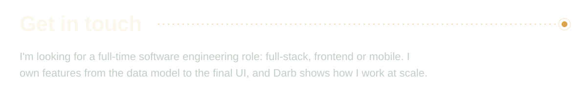
</picture>

  

© 2026 Nour Alden Mousa

